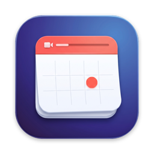
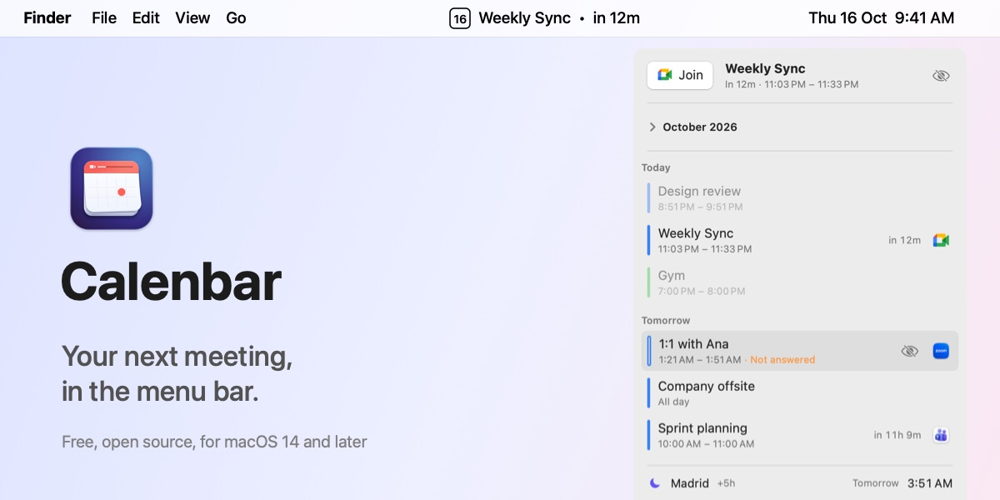

  

<h1 align="center">Calenbar</h1>

  Your next meeting, in the menu bar. 
  A small native Mac app: the current or upcoming event next to the clock, with a countdown, and one click to join the call.

  

  
  
  

  

## What it does

- **Always in view.** The menu bar shows today's date and the next event: `Weekly Sync • in 12m`, then `now`, then `25m left`. You choose how far ahead it looks, from the next hour to the whole week.
- **One click to join.** Google Meet, Zoom, Microsoft Teams, Webex, Slack huddles and FaceTime. Zoom and Teams open in their apps when installed.
- **A panel for the day.** Today and tomorrow, a month view, world clocks, and a card per event: the time in your other time zones, the room, who's coming and who said yes, the notes.
- **Hard to miss.** A notification before each meeting, an optional full-screen alert when it starts, and the bar flashing red in the last minutes.
- **Your calendars, as they are.** Works with any account the Mac's Calendar knows (Google, Exchange, iCloud). Events never leave your Mac.
- **Low maintenance.** Updates itself. English and Spanish.

## Install

1. [Download Calenbar.dmg](https://github.com/hercase/calenbar/releases/latest/download/Calenbar.dmg) and drag Calenbar to Applications.
2. The first time, macOS says it can't verify the app. Click **Done**, then **System Settings › Privacy & Security › Open Anyway**. Once.
3. Allow access to Calendars and Notifications.

Step-by-step with pictures: [the install guide](https://hercase.github.io/calenbar/install.html). Release notes: [What's new](https://hercase.github.io/calenbar/whats-new.html).

## Building

Swift Package Manager with the Xcode Command Line Tools; no Xcode needed. [CONTRIBUTING.md](CONTRIBUTING.md) has the scripts, the quality gates and how releases work.

## Credits

Made by [Hernan Case](https://hercase.vercel.app/?utm_source=calenbar&utm_medium=github). Updates by [Sparkle](https://sparkle-project.org). [MIT license](LICENSE).
