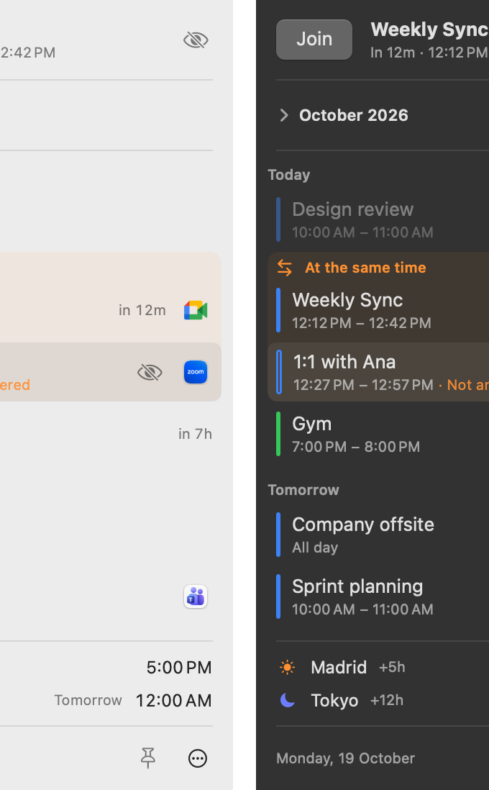

# Calenbar

Your next meeting, in the menu bar. A small native Mac app: it keeps the current or upcoming event next to the clock with a countdown, and joins the call in one click.

<picture>
  <source media="(prefers-color-scheme: dark)" srcset="docs/img/panel-dark.png">
  
</picture>

**[Download for Mac](https://github.com/hercase/calenbar/releases/latest/download/Calenbar.dmg)** · macOS 14 or later · [Website and install guide](https://hercase.github.io/calenbar/)

- Menu bar item with a live countdown: `Weekly Sync • in 12m`, then `now`, then `25m left`.
- One click to join Google Meet, Zoom, Teams, Webex, Slack huddles and FaceTime.
- A panel with today and tomorrow, a month view, world clocks, and a card per event: time zones, room, guests and their replies.
- A notification before each meeting, an optional full-screen alert, and the bar flashing red in the last minutes.
- Works with any account the Mac's Calendar knows (Google, Exchange, iCloud). Events never leave your Mac.
- Updates itself. English and Spanish.

## Building

Swift Package Manager with the Xcode Command Line Tools; no Xcode needed. See [CONTRIBUTING.md](CONTRIBUTING.md) for the scripts, the quality gates and how releases work.

## Credits

Made by [Hernan Case](https://hercase.vercel.app/?utm_source=calenbar&utm_medium=github). Updates by [Sparkle](https://sparkle-project.org). [MIT license](LICENSE).
